# PokéWatch

A standalone watchOS app that behaves like an animated Pokémon watch face, for Apple Watch Ultra 3
(49 mm, 422 × 514). Native Swift and SwiftUI, entirely offline, no third-party dependencies,
no analytics. A personal, non-commercial project.

| Electric | Pokémon Yellow | Minimal | Sleeping | Pokédex | Analog |
| --- | --- | --- | --- | --- | --- |
| 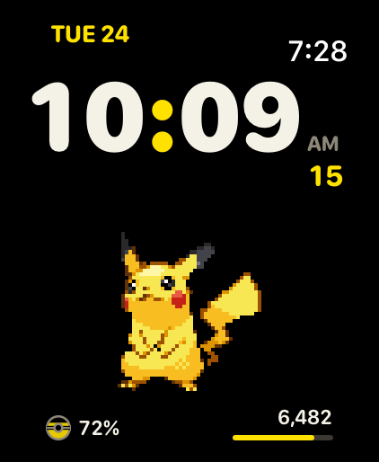 | 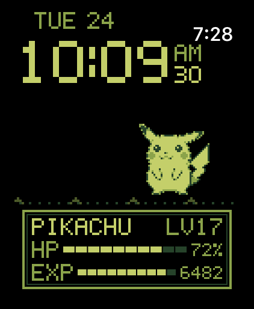 | 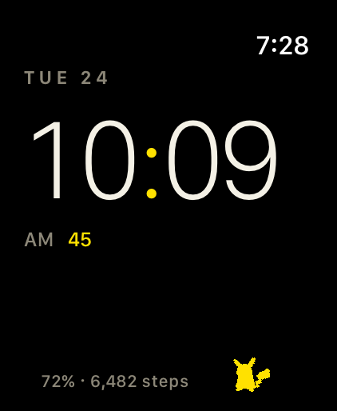 | 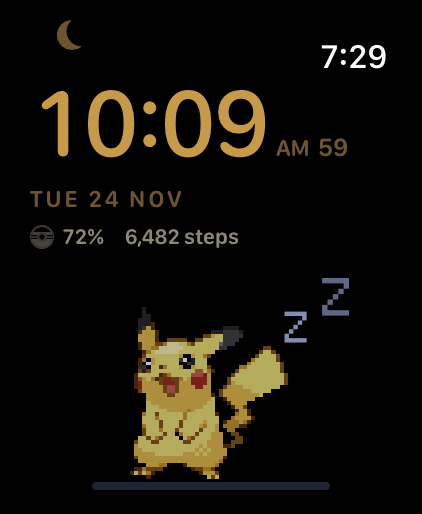 | 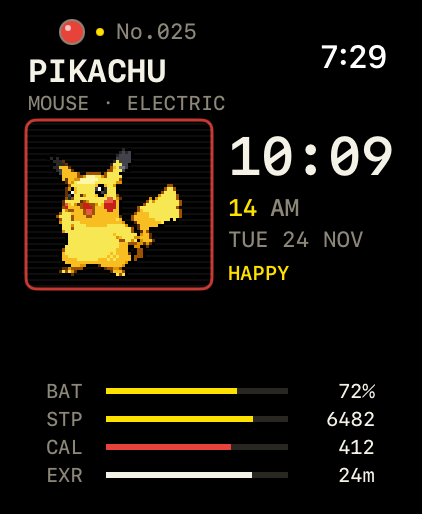 | 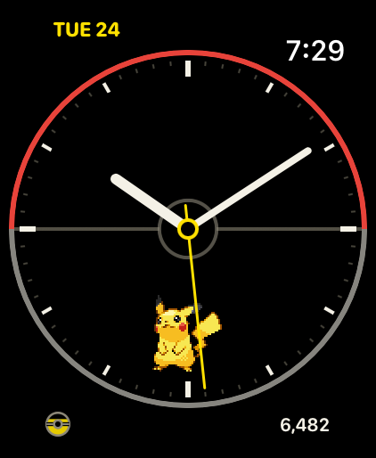 |
| 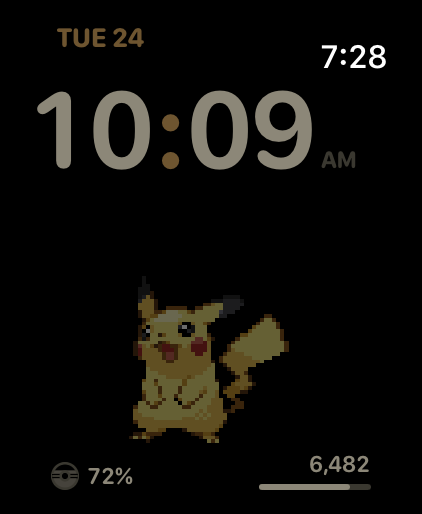 | 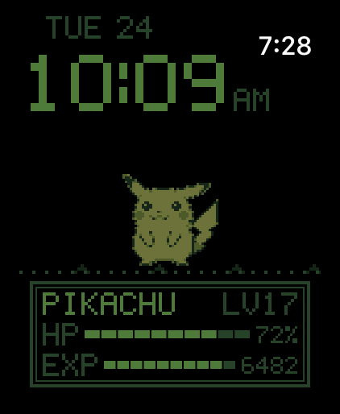 | 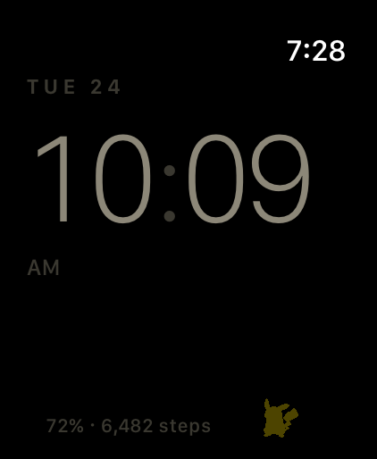 | 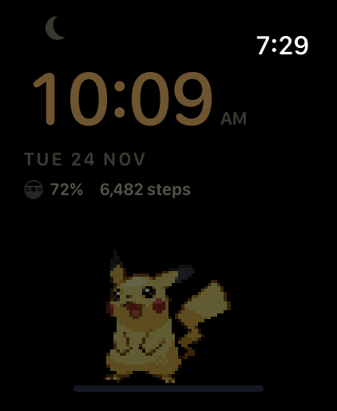 | 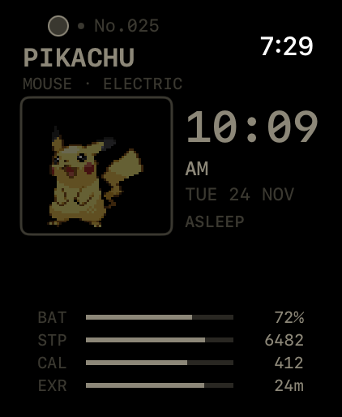 | 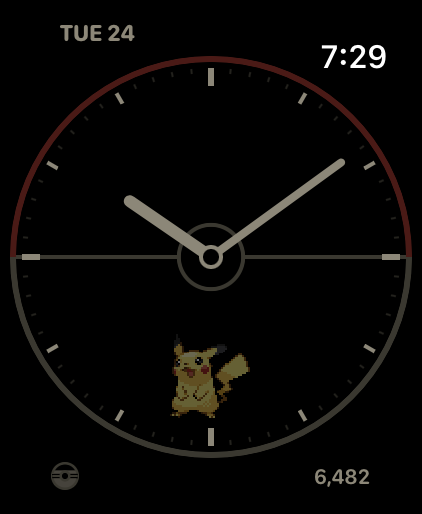 |

Bottom row: the reduced-luminance (Always-On) design, rendered in the simulator with `--dimmed`.

## What's in it

- **Six faces**: Electric, Pokémon Yellow (green / monochrome / yellow palettes), Minimal, Sleeping,
  Pokédex, Analog (Pokéball dial; the Pokémon moves to whichever part of the dial the hands leave free).
- **Sixteen companions**: Pikachu, Eevee, Gengar, Snorlax, Charmander, Squirtle, Bulbasaur, Mew, Umbreon,
  Psyduck, Charizard, Mewtwo, Lucario, Dragonite, Jigglypuff, Espeon. Each has its own idle motion,
  particles, voice lines and temperament (Gengar is a night owl, Snorlax naps when your steps stall, …).
- **Every generation's sprites**: Gen I Yellow, Gen II Crystal, Gen III Emerald, Gen IV HeartGold,
  Gen V Black/White and Modern (Showdown), normal or shiny. Animated wherever the games animated them;
  Gen I stills get motion from the companion engine. Imported at build time by
  `Scripts/import_sprites.py` and never committed (see [ASSETS.md](Documentation/ASSETS.md)).
  Without an import, the app falls back to original pixel art.
- **Behaviour**: idle, blinking, sleeping, waking, happy, tap reaction, low battery, charging, goal
  celebration and time-of-day moods. See [Documentation/ARCHITECTURE.md](Documentation/ARCHITECTURE.md).
- **Always-On**: static sleeping pose, no seconds, dimmed palette, minute-cadence timeline, wake-up
  animation on wrist raise. See [Documentation/ALWAYS_ON.md](Documentation/ALWAYS_ON.md).
- **Optional HealthKit** (read-only): steps, active energy, exercise minutes, activity rings, optional
  latest heart rate. Everything works when access is denied.
- **Complications** (WidgetKit): circular, corner, rectangular and inline, in full colour and tinted.
- **Customization**: long-press the face. Crown browses Pokémon and faces; a settings page covers accent,
  clock format, seconds, date, battery, activity, animation intensity, Always-On look, haptics,
  reduced motion and step goal.

## Interaction

| Gesture | Action |
| --- | --- |
| Tap the Pokémon | Reaction (hop, happy eyes, a line of dialogue) |
| Double-tap elsewhere | Next animation routine (idle → play → dance → wander) |
| Long-press | Customization |
| Swipe left / right | Next / previous face |
| Digital Crown (in customization) | Browse Pokémon or faces |

## Build

Requirements: Xcode 26.6+ (watchOS 26 SDK) or Xcode 27, [XcodeGen](https://github.com/yonaskolb/XcodeGen),
a watchOS simulator runtime (`xcodebuild -downloadPlatform watchOS`).

```sh
python3 Scripts/import_sprites.py   # fetch sprites (needs Pillow; once, at build time)
Scripts/generate.sh        # PokeWatch.xcodeproj from project.yml
Scripts/build.sh           # simulator build
Scripts/test.sh            # unit tests on the Ultra 3 simulator
Scripts/run-simulator.sh --demo          # install + launch with demo data
Scripts/screenshots.sh     # layout matrix into Documentation/Screenshots
Scripts/check_clipping.py build/device-mask.png Documentation/Screenshots/face-*.png   # nothing under the rounded corners
```

Installation on a watch (TestFlight or Xcode): [Documentation/INSTALL.md](Documentation/INSTALL.md).

## Documentation

- [ARCHITECTURE.md](Documentation/ARCHITECTURE.md): modules, rendering, performance choices
- [ALWAYS_ON.md](Documentation/ALWAYS_ON.md): Always-On behaviour and Return to Clock
- [ADDING_CHARACTERS.md](Documentation/ADDING_CHARACTERS.md): new Pokémon without code changes
- [ASSETS.md](Documentation/ASSETS.md): artwork and font provenance
- [INSTALL.md](Documentation/INSTALL.md): TestFlight, Xcode and the device checklist
- [LIMITATIONS.md](Documentation/LIMITATIONS.md): what watchOS doesn't allow

## Legal

Pokémon and the character names are trademarks of Nintendo, Creatures Inc. and GAME FREAK inc.
This project is unaffiliated and non-commercial. Game sprites are fetched at build time for
personal use and are not part of this repository. See [ASSETS.md](Documentation/ASSETS.md).
